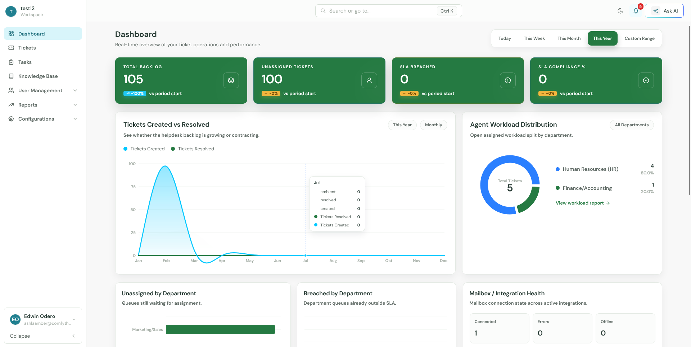
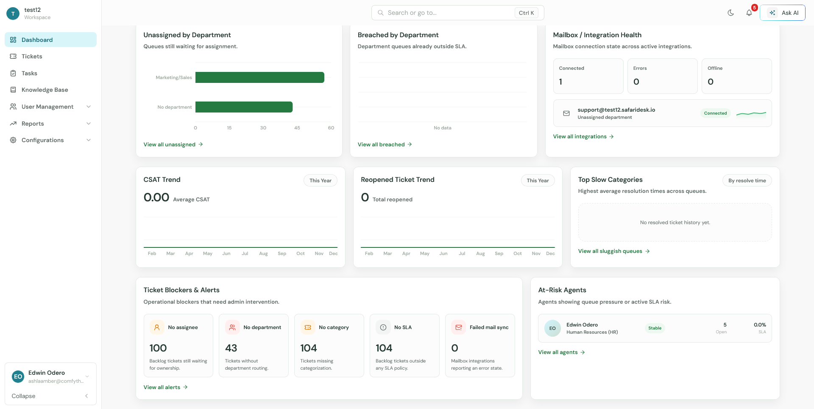
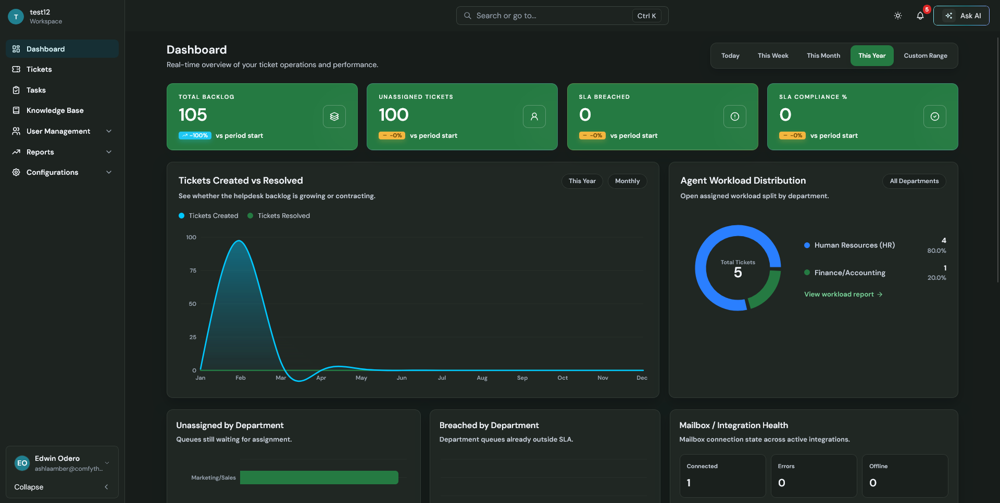

# SafariDesk

Open-source help desk software for teams that want modern ticket operations, clear reporting, and a self-hosted deployment path that does not require stitching multiple repositories together.

SafariDesk brings the frontend, backend, deployment assets, Docker Compose stack, and self-hosting documentation into one repository so teams can run, update, back up, and support their installation from a single place.

<p>
  <a href="https://docs.safaridesk.io/installation">Installation</a>
  ·
  <a href="https://docs.safaridesk.io/production">Production</a>
  ·
  <a href="https://docs.safaridesk.io/configuration">Configuration</a>
  ·
  <a href="https://docs.safaridesk.io/update">Updates</a>
  ·
  <a href="https://docs.safaridesk.io/troubleshooting">Troubleshooting</a>
</p>



## What SafariDesk Includes

- Ticket management for support queues, ownership, departments, categories, and SLA operations.
- Operational dashboards for backlog, unassigned tickets, breached SLA queues, workload distribution, CSAT, reopened tickets, and mailbox health.
- Knowledge base, task tracking, reporting, user management, and configuration workflows.
- Mailbox and integration health visibility for connected support channels.
- Optional AI-provider configuration for deployments that enable AI-assisted workflows.
- A production-oriented self-hosted stack with Django, React, PostgreSQL, Redis, Celery, Channels, and Nginx.

## Why This Repository Exists

SafariDesk was previously split across separate frontend and backend repositories. This monorepo is designed for self-hosting:

- One repository to clone.
- One root `.env` file.
- One root Docker Compose stack.
- One release version for frontend and backend.
- One documentation path for installation, configuration, updates, backup, and troubleshooting.
- Two SafariDesk application images published for deployment.

## Quick Start

Start from the repository root.

```bash
cp .env.example .env
docker compose pull
docker compose up -d
sh deploy/scripts/migrate.sh
sh deploy/scripts/collectstatic.sh
sh deploy/scripts/create-admin.sh
docker compose exec backend python manage.py safari
docker compose exec backend python manage.py sync_email_templates
```

Open:

```text
http://localhost
```

For production, read the full guide first:

```text
https://docs.safaridesk.io/installation
```

## Docker Images

SafariDesk publishes two application images:

```text
safaridesk/safaridesk-frontend
safaridesk/safaridesk-backend
```

The backend image is reused by four services:

- `backend`
- `channels`
- `worker`
- `beat`

The first official release is tagged:

```text
v1.0.0
```

Production deployments should pin `SAFARIDESK_IMAGE_TAG` instead of relying on `latest`.

```env
DOCKERHUB_NAMESPACE=safaridesk
SAFARIDESK_IMAGE_TAG=v1.0.0
```

## Architecture

The default self-hosted deployment keeps only Nginx public.

```text
Browser
  |
  v
nginx
  |-- /          -> frontend
  |-- /api/      -> backend
  |-- /ws/       -> channels
  |-- /uploads/  -> backend media
  |-- /static/   -> collected static files
  |
  v
private Docker network
  |-- PostgreSQL with pgvector
  |-- Redis
  |-- Celery worker
  |-- Celery beat
```

Default services:

| Service | Purpose | Public |
|---|---|---:|
| `nginx` | Reverse proxy for frontend, API, WebSockets, uploads, and static files | Yes |
| `frontend` | Built React/Vite application | No |
| `backend` | Django API via Gunicorn | No |
| `channels` | Django Channels WebSocket server via Daphne | No |
| `worker` | Celery background jobs | No |
| `beat` | Celery scheduled jobs | No |
| `db` | PostgreSQL with pgvector | No |
| `redis` | Redis for Celery, cache, and Channels | No |

Read more:

```text
https://docs.safaridesk.io/architecture
```

## Screenshots

### Operations Dashboard



### Dark Mode



## Repository Layout

```text
frontend/       React + Vite frontend
backend/        Django API, Channels, Celery, migrations, templates
deploy/         Nginx configs and operational scripts
docs/           Self-hosting and development documentation
data/           Local bind-mount targets for backups and runtime data
.github/        CI, Docker image build, and release workflows
```

## Configuration

SafariDesk self-hosting uses a single root `.env` file.

Important configuration groups:

- Domains and URLs
- Security secrets
- PostgreSQL
- Redis and Celery
- Frontend public build-time config
- Email and SMTP
- Admin bootstrap
- OAuth and mail integrations
- AI providers
- Billing and licensing
- Docker image tags

Full reference:

```text
https://docs.safaridesk.io/configuration
```

## Production Notes

Before exposing SafariDesk publicly:

- Set `DEBUG=false`.
- Replace all default secrets.
- Pin `SAFARIDESK_IMAGE_TAG`.
- Configure `ALLOWED_HOSTS`, `CORS_ALLOWED_ORIGINS`, and `CSRF_TRUSTED_ORIGINS`.
- Keep PostgreSQL, Redis, backend, Channels, worker, and beat private.
- Put TLS in front of the root Nginx service.
- Back up PostgreSQL, uploads, and `.env`.

Production guide:

```text
https://docs.safaridesk.io/production
```

## Documentation

| Topic | Link |
|---|---|
| Installation | <https://docs.safaridesk.io/installation> |
| Architecture | <https://docs.safaridesk.io/architecture> |
| Configuration | <https://docs.safaridesk.io/configuration> |
| Docker images and releases | <https://docs.safaridesk.io/docker-images-and-releases> |
| Production deployment | <https://docs.safaridesk.io/production> |
| Updates | <https://docs.safaridesk.io/update> |
| Backup and restore | <https://docs.safaridesk.io/backup-restore> |
| Troubleshooting | <https://docs.safaridesk.io/troubleshooting> |

Local copies live under:

```text
docs/self-hosting/
```

## Development

Build from source:

```bash
docker compose up -d --build
```

Run backend maintenance commands:

```bash
sh deploy/scripts/migrate.sh
sh deploy/scripts/collectstatic.sh
sh deploy/scripts/create-admin.sh
```

Follow logs:

```bash
docker compose logs -f --tail=200
```

Validate Compose:

```bash
docker compose config --quiet
```

## Release

The monorepo uses one SafariDesk version for frontend and backend together.

Recommended release tag format:

```text
v1.0.0
```

Docker publishing is handled by:

```text
.github/workflows/docker-build.yml
```

Required GitHub settings:

- `DOCKERHUB_USERNAME`
- `DOCKERHUB_TOKEN`
- `DOCKERHUB_NAMESPACE`

## License

See [LICENSE](LICENSE).
